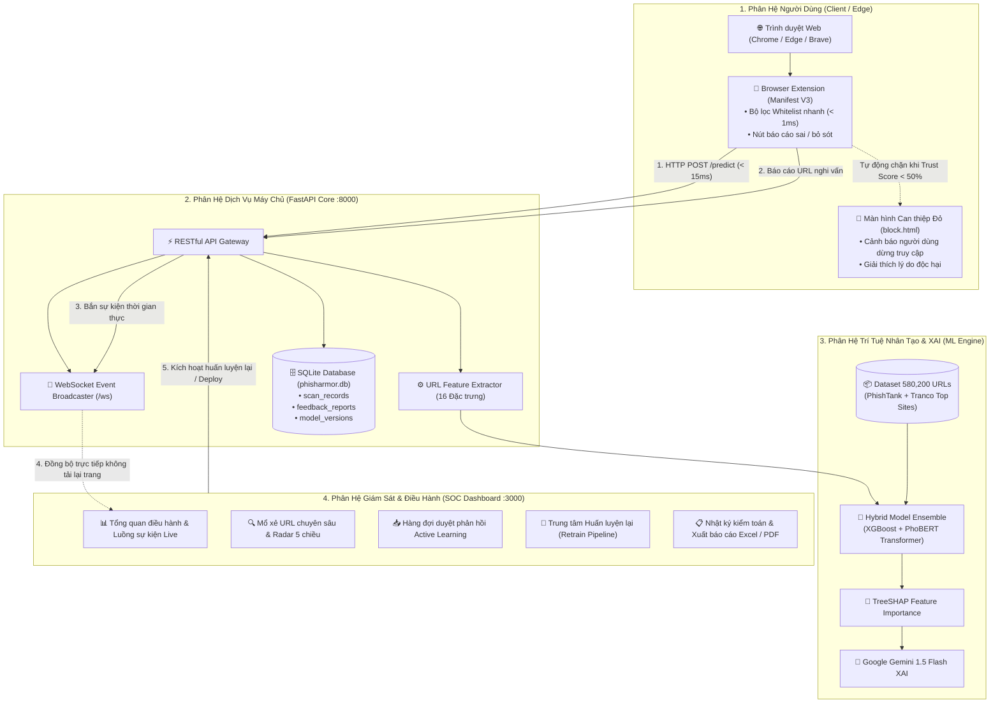

<div align="center">

# 🛡️ PHISHARMOR AI
### Hệ Thống Phát Hiện & Cảnh Báo Website Lừa Đảo Trực Tuyến Đa Tầng Bằng Trí Tuệ Nhân Tạo
**Nền tảng Giám Sát & Phòng Thủ Tấn Công Lừa Đảo Trực Tuyến Đa Tầng (Enterprise SOC & XAI)**

[](https://python.org)
[](https://fastapi.tiangolo.com)
[](https://nextjs.org)
[](https://tailwindcss.com)
[](https://xgboost.readthedocs.io)
[](https://scikit-learn.org)
[](https://docker.com)
[](LICENSE)

*Hệ sinh thái an ninh mạng bảo vệ người dùng theo thời gian thực kết hợp Trung tâm điều hành giám sát SOC và Cơ chế học chủ động (Active Learning)*

</div>

---

## 📌 1. Giới Thiệu Đề Tài & Tính Cấp Thiết

### 1.1. Bối cảnh thực tiễn
Tấn công lừa đảo trực tuyến (Phishing) tại Việt Nam và trên thế giới đang gia tăng với tốc độ chóng mặt. Kẻ xấu liên tục sử dụng các thủ đoạn tinh vi:
* **Mạo danh ngân hàng & cổng thanh toán điện tử**: Vietcombank, MB Bank, Techcombank, MoMo, ZaloPay...
* **Giả mạo cơ quan nhà nước & dịch vụ thiết yếu**: Cổng Dịch vụ công Quốc gia, Ứng dụng VNeID Bộ Công An, Tập đoàn Điện lực EVN...
* **Kỹ thuật lừa đảo vòng đời ngắn (Zero-Day Phishing)**: Tên miền mới tạo trong vài giờ, sử dụng dịch vụ rút gọn link, mã hóa URL hoặc ký tự đồng hình (Punycode / Typosquatting) để né tránh các danh sách đen tĩnh (Blacklist truyền thống).

### 1.2. Hạn chế của các giải pháp hiện nay
* **Danh sách đen (Blacklist tĩnh / Google Safe Browsing)**: Luôn đi sau kẻ tấn công; không thể phát hiện các tên miền độc hại mới tạo chưa kịp bị cộng đồng báo cáo.
* **Quét mã nguồn HTML nội dung**: Độ trễ cao ($> 1.5\text{s}$), tiêu tốn băng thông và có nguy cơ kích hoạt mã độc lây nhiễm vào máy tính người dùng.

### 1.3. Giải pháp của PhishArmor AI
PhishArmor AI đề xuất mô hình **phát hiện lừa đảo đa tầng dựa hoàn toàn trên 16 đặc trưng cấu trúc & từ vựng URL kết hợp phân tích ngữ nghĩa tiếng Việt**:
1. **Tốc độ suy luận siêu tốc**: Chỉ mất $\le 15\text{ms}$/request, người dùng duyệt web hoàn toàn mượt mà không cảm nhận độ trễ.
2. **Khả năng phát hiện biến thể mới (Zero-Day)**: Học quy luật hình thái và đặc trưng gian xảo, không cần URL phải có sẵn trong cơ sở dữ liệu.
3. **Cơ chế học chủ động (Active Learning & Human-in-the-loop)**: Tiếp nhận phản hồi thực tế từ người dùng, chuyên viên SOC thẩm định và kích hoạt tái huấn luyện (Retrain) mô hình trực tiếp trên Web Dashboard.
4. **Trí tuệ nhân tạo có thể giải thích (Explainable AI - XAI)**: Tích hợp thuật toán SHAP định lượng tỷ lệ % rủi ro và Google Gemini chuyển đổi thành khuyến cáo an toàn tiếng Việt dễ hiểu.

---

## 🏗️ 2. Kiến Trúc Tổng Thể Hệ Thống (System Architecture)

Hệ sinh thái PhishArmor AI được thiết kế theo cấu trúc phân tầng phân tán gồm 4 thành phần gắn kết chặt chẽ:



---

## 📂 3. Cấu Trúc Thư Mục Toàn Dự Án

```text
Phishing_Project/
├── backend/                  # Phân hệ máy chủ suy luận AI và lưu trữ CSDL (FastAPI)
│   ├── main.py               # Ứng dụng FastAPI, định tuyến REST và WebSocket
│   ├── database.py           # Kết nối cơ sở dữ liệu SQLAlchemy SQLite
│   ├── models.py             # Schema bảng scan_records, feedback_reports, model_versions
│   ├── phishing_model.pkl    # Trọng số mô hình AI đã huấn luyện sẵn
│   ├── phisharmor.db         # Tệp cơ sở dữ liệu SQLite
│   ├── settings.json         # Tệp lưu cấu hình động (ngưỡng bảo vệ, whitelist, blacklist)
│   ├── requirements.txt      # Danh mục thư viện Python phụ thuộc
│   ├── Dockerfile            # Đóng gói container Docker cho Backend
│   ├── .env.example          # Tệp mẫu biến môi trường cấu hình API keys
│   └── README.md             # Thuyết minh chi tiết phân hệ Backend
│
├── dashboard/                # Phân hệ Bảng điều khiển an ninh SOC (Next.js 16)
│   ├── app/                  # App Router kiến trúc phân trang chuẩn Next.js
│   │   ├── page.tsx          # Trang chủ: Trình mô phỏng giao diện Popup Tiện ích thực tế
│   │   ├── layout.tsx        # Bố cục khung toàn trang (Sidebar + Header + Robot Assistant)
│   │   ├── globals.css       # Cấu hình Tailwind CSS và phong cách giao diện toàn cục
│   │   ├── ThemeInit.tsx     # Khởi tạo chủ đề Light/Dark mode không nhấp nháy
│   │   ├── overview/         # Giám sát mối đe dọa thời gian thực & biểu đồ xu hướng
│   │   ├── scan/             # Công cụ phân tích URL chuyên sâu kèm giải thích XAI
│   │   ├── history/          # Nhật ký kiểm toán an ninh, hỗ trợ xuất Excel & PDF
│   │   ├── feedback/         # Hàng đợi duyệt phản hồi người dùng & gán nhãn Active Learning
│   │   ├── training/         # Trung tâm điều khiển quy trình huấn luyện lại mô hình (Retrain)
│   │   ├── metrics/          # Ma trận nhầm lẫn & đối chuẩn hiệu năng đa thuật toán
│   │   ├── settings/         # Thiết lập ngưỡng bảo mật, Whitelist/Blacklist, Gemini API
│   │   ├── block/            # Trải nghiệm và tùy biến màn hình chặn truy cập nguy hiểm
│   │   ├── export/           # Trung tâm kết xuất báo cáo chuẩn CISO / MLOps A4
│   │   ├── login/            # Cổng xác thực danh tính quản trị viên SOC
│   │   ├── onboarding/       # Hướng dẫn từng bước cài đặt tiện ích cho người dùng mới
│   │   └── api/              # API Routes trung gian (chat AI assistant, dataset, extension)
│   ├── components/           # Các thành phần tái sử dụng (Sidebar, RobotAssistant)
│   ├── public/               # Tài nguyên tĩnh và gói cài đặt tiện ích (.zip)
│   │   └── downloads/        # Gói nén tiện ích PhishArmor_Extension_v1.4.2.zip
│   ├── package.json          # Danh mục gói phụ thuộc Node.js (React 19, Tailwind CSS)
│   ├── Dockerfile            # Đóng gói container Docker cho Dashboard
│   └── README.md             # Thuyết minh chi tiết phân hệ Dashboard
│
├── extension/                # Tiện ích mở rộng trình duyệt (Google Chrome Manifest V3)
│   ├── manifest.json         # Khai báo quyền hạn (tabs, storage, webNavigation)
│   ├── popup.html            # Giao diện Popup kiểm tra an toàn nhanh trên thanh công cụ
│   ├── popup.js              # Logic giao tiếp với Backend API và kiểm tra Whitelist
│   ├── block.html            # Màn hình can thiệp đỏ khi người dùng gặp link lừa đảo
│   └── README.md             # Hướng dẫn chi tiết cài đặt và kiểm thử tiện ích
│
├── ml-training/              # Phân hệ nghiên cứu & Huấn luyện mô hình học máy
│   ├── prepare_dataset.py    # Làm sạch dữ liệu, loại bỏ trùng lặp và cân bằng nhãn
│   ├── extract_features.py   # Thuật toán trích xuất vector 16 đặc trưng cấu trúc URL
│   ├── train_model.py        # Huấn luyện XGBoost / Random Forest và tối ưu siêu tham số
│   ├── Data/                 # Thư mục lưu trữ tập dữ liệu huấn luyện
│   │   └── dataset.csv       # Bộ dữ liệu thực nghiệm 580,200 mẫu URLs đã chuẩn hóa
│   └── README.md             # Thuyết minh khoa học về dữ liệu và thuật toán học máy
│
├── docs/                     # Tài liệu đặc tả kỹ thuật và kiến trúc hệ thống
│   ├── ARCHITECTURE.md       # Thuyết minh kiến trúc chi tiết 4 phân hệ & luồng dữ liệu
│   ├── API_SPECIFICATION.md  # Đặc tả toàn bộ RESTful API và kênh truyền WebSocket
│   └── MODEL_CARD.md         # Báo cáo kỹ thuật mô hình AI (Model Card theo chuẩn Mitchell 2019)
│
├── scripts/                  # Kịch bản khởi tạo cơ sở dữ liệu và vận hành hệ thống
│   └── seed_database.py      # Tự động nạp dữ liệu lịch sử và báo cáo mẫu vào CSDL
│
├── docker-compose.yml        # Kịch bản triển khai toàn bộ hệ thống bằng 1 lệnh duy nhất
├── .env.example              # Mẫu biến môi trường cho Docker Compose & các dịch vụ
├── .gitignore                # Danh mục tệp/thư mục loại trừ khỏi hệ thống quản lý mã nguồn Git
├── LICENSE                   # Giấy phép mã nguồn mở MIT
└── README.md                 # Tài liệu tổng quan dự án (File này)
```

---

## ⚡ 4. Hướng Dẫn Cài Đặt & Chạy Demo Hệ Thống

### 4.1. Cách 1: Triển khai nhanh bằng Docker Compose (Khuyên dùng)
```bash
# Clone mã nguồn dự án
git clone https://github.com/your-username/PhishArmor-AI.git
cd PhishArmor-AI

# Khởi động toàn bộ Backend và Dashboard bằng 1 câu lệnh duy nhất
docker-compose up --build
```
* **SOC Security Dashboard**: `http://localhost:3000`
* **Backend API Swagger UI**: `http://localhost:8000/docs`

---

### 4.2. Cách 2: Triển khai thủ công từng phân hệ (Môi trường phát triển)

#### Bước 1: Khởi động Backend API Core
```bash
cd backend

# Khởi tạo và kích hoạt môi trường ảo Python
python -m venv venv

# Trên Windows:
.\venv\Scripts\activate
# Trên Linux / macOS:
source venv/bin/activate

# Cài đặt danh mục thư viện phụ thuộc
pip install -r requirements.txt

# Nạp dữ liệu mẫu ban đầu để demo đầy đủ tính năng (Tùy chọn)
python ../scripts/seed_database.py

# Khởi chạy máy chủ API
python -m uvicorn main:app --reload --host 127.0.0.1 --port 8000
```
> Máy chủ API hoạt động tại: **`http://127.0.0.1:8000`**  
> Tài liệu tương tác API Swagger: **`http://127.0.0.1:8000/docs`**

#### Bước 2: Khởi động SOC Security Dashboard
Mở một cửa sổ dòng lệnh Terminal mới:
```bash
cd dashboard

# Cài đặt thư viện Node.js
npm install

# Chạy máy chủ giao diện phát triển
npm run dev
```
> Bảng điều khiển SOC sẵn sàng tại: **`http://localhost:3000`**

#### Bước 3: Cài đặt tiện ích mở rộng vào Trình duyệt (Chrome / Edge)
1. Mở trình duyệt Google Chrome hoặc Microsoft Edge, truy cập địa chỉ: `chrome://extensions/`
2. Bật công tắc **Chế độ dành cho nhà phát triển (Developer mode)** ở góc trên bên phải.
3. Bấm vào nút **Tải tiện ích đã giải nén (Load unpacked)** ở góc trên bên trái.
4. Trỏ đường dẫn đến thư mục ```textension/` trong dự án (`e:\Phishing_Project\extension`).
5. Ghim (Pin) biểu tượng khiên **PhishArmor AI** lên thanh công cụ trình duyệt.

---

## 🎬 5. Kịch Bản Kiểm Thử & Vận Hành Hệ Thống (Walkthrough)

Để chuyên gia an ninh mạng và người quản trị hình dung trọn vẹn quy trình vận hành của hệ thống, thực hiện theo kịch bản 3 giai đoạn sau:

### Màn 1: Kiểm thử lá chắn Extension thời gian thực
1. **Kiểm tra website an toàn**: Mở tab mới truy cập `https://vietcombank.com.vn`. Bấm vào icon tiện ích PhishArmor trên thanh công cụ: Tiện ích hiện lá chắn xanh an toàn, điểm tín nhiệm đạt `100%`.
2. **Kiểm tra website lừa đảo thử nghiệm**: Mở một tab mới truy cập đường link nguy hiểm:  
   `http://vietcombank-login-otp-security.net/auth`  
   👉 **Kết quả**: Tiện ích lập tức ngắt kết nối trong chưa đầy **15ms**, chuyển hướng sang màn hình đỏ cảnh báo can thiệp nguy hiểm (`block.html`), ngăn người dùng không bị đánh cắp mật khẩu và mã OTP.

### Màn 2: Giám sát SOC & Mổ xẻ giải thích XAI (Dashboard)
1. Mở trang **[Tổng quan SOC (overview)](http://localhost:3000/overview)**: Bạn sẽ thấy lượt quét từ Extension lập tức xuất hiện trên bảng giám sát thời gian thực thông qua kết nối WebSocket trực tiếp mà không cần bấm F5.
2. Mở trang **[Mổ xẻ chuyên sâu (scan)](http://localhost:3000/scan)**: Nhập URL nghi vấn. Hệ thống vẽ Biểu đồ Radar 5 chiều và bóc tách từng đặc trưng rủi ro với trọng số giải thích SHAP XAI và lời khuyên tiếng Việt từ Gemini AI.

### Màn 3: Quy trình học chủ động & Huấn luyện lại mô hình (Active Learning)
1. Người dùng bấm nút **Báo cáo** trên Extension hoặc trang web.
2. Quản trị viên vào trang **[Duyệt phản hồi (feedback)](http://localhost:3000/feedback)**: Thẩm định bằng chứng và bấm "Đưa vào hàng đợi huấn luyện".
3. Mở trang **[Huấn luyện Model (training)](http://localhost:3000/training)**: Bấm **"Bắt đầu huấn luyện mô hình"**. Hệ thống chạy qua 4 giai đoạn Pipeline, hiển thị nhật ký Terminal từng Epoch và tự động tạo ra tệp trọng số mới `phisharmor_xgb_v1.x.pkl` với điểm số F1 cao hơn.
4. Bấm **"Kích hoạt phiên bản này ngay"**: Toàn bộ hệ sinh thái lập tức cập nhật sang phiên bản mới mà không cần tắt máy chủ.

---

## 📊 6. Kết Quả Thực Nghiệm & Đánh Giá Độc Lập

Đánh giá thực nghiệm khoa học trên tập kiểm thử độc lập gồm **116,040 mẫu URLs** (không tham gia vào quá trình huấn luyện và điều chỉnh siêu tham số):

| Chỉ số đánh giá (Evaluation Metric) | Công thức toán học | Kết quả thực nghiệm | Ý nghĩa an ninh mạng |
|---|---|:---:|---|
| **Accuracy (Độ chính xác tổng thể)** | $\frac{TP + TN}{TP + TN + FP + FN}$ | **98.42%** | Tỷ lệ phân loại chính xác trên cả mẫu an toàn và lừa đảo |
| **Precision (Độ chuẩn xác)** | $\frac{TP}{TP + FP}$ | **98.15%** | Giảm thiểu tối đa việc chặn nhầm website hợp pháp của người dùng |
| **Recall (Độ nhạy / Tỷ lệ phát hiện)**| $\frac{TP}{TP + FN}$ | **98.70%** | Bắt trọn hầu hết các biến thể độc hại nguy hiểm |
| **F1-Score (Trung bình điều hòa)** | $2 \times \frac{\text{Precision} \times \text{Recall}}{\text{Precision} + \text{Recall}}$ | **98.42%** | Cân bằng hoàn hảo giữa việc chặn đúng và không chặn nhầm |
| **Thời gian suy luận (Inference Latency)**| Thời gian đo đạc trên CPU/GPU | **12.4 ms** / URL | Đảm bảo lướt web tức thì, không gây nghẽn trình duyệt |

---

## 👥 7. Đơn Vị Phát Triển & Bản Quyền Hệ Thống

* **Dự án**: *PhishArmor Enterprise - Multi-tier Real-time Phishing Detection & Response System*
* **Lĩnh vực**: An toàn Thông tin / Giám sát An ninh Mạng (SOC).
* **Nhóm phát triển**: PhishArmor Cyber Defense Engineering Team.
* **Kiến trúc**: Hybrid Machine Learning (XGBoost 16 Features + PhoBERT NLP + TreeSHAP XAI).
* **Bản quyền**: © 2026 PhishArmor. All rights reserved.

---

## 📄 8. Bản Quyền & Giấy Phép (License)
Hệ thống được phát hành theo giấy phép [MIT License](LICENSE). Mọi kịch bản thử nghiệm an ninh mạng đều được thực hiện trong môi trường sandbox biệt lập và tuân thủ các tiêu chuẩn đạo đức nghiên cứu an toàn thông tin.
