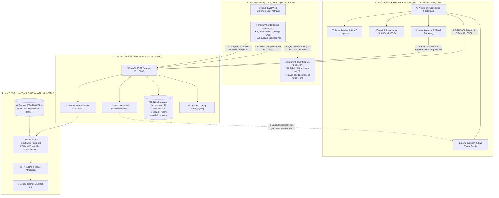
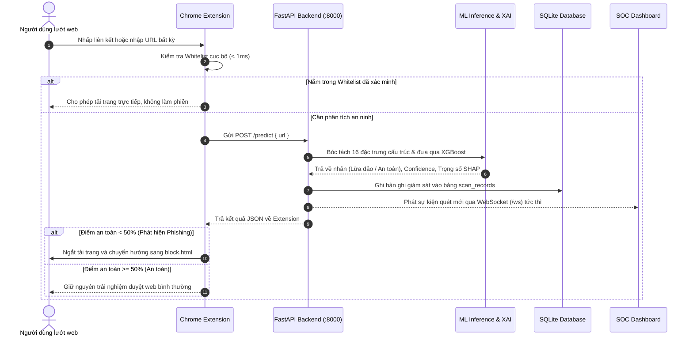
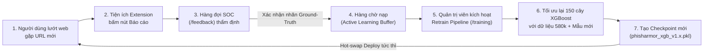

# THUYẾT MINH KIẾN TRÚC HỆ THỐNG PHISHARMOR AI
### PhishArmor Enterprise: Hệ thống phòng chống tấn công lừa đảo trực tuyến ứng dụng học máy đa tầng và giải thích mô hình (XAI)

---

## 1. Tổng Quan Kiến Trúc (Architectural Overview)

PhishArmor AI được thiết kế theo mô hình kiến trúc phân tầng chuyên biệt (**Multi-tier Decoupled Architecture**), phân tách rõ ràng giữa:
1. Khả năng can thiệp trực tiếp và tức thì trên trình duyệt người dùng cuối (Client Edge).
2. Động cơ trích xuất đặc trưng & suy luận học máy bất đồng bộ tại máy chủ trung tâm (Backend Core).
3. Hệ thống mô hình học máy kết hợp (Hybrid Ensemble) và mô hình giải thích (Explainable AI - XAI).
4. Trung tâm chỉ huy, điều hành an ninh và học chủ động (SOC Dashboard & Active Learning Loop).

Kiến trúc này giúp hệ thống đạt được hai mục tiêu tối thượng:
* **Thời gian đáp ứng cực ngắn ($\le 15\text{ms}$)**: Đảm bảo trải nghiệm lướt web của người dùng không hề bị chậm hay gián đoạn.
* **Khả năng tự học và thích ứng liên tục (Self-evolving)**: Không bị lỗi thời trước các thủ đoạn lừa đảo biến đổi hàng ngày của tin tặc.

---

## 2. Sơ Đồ Kiến Trúc Toàn Hệ Thống (System Architecture Diagram)

---

## 3. Luồng Xử Lý Dữ Liệu Thời Gian Thực (Data Flow Sequence)

Quy trình phát hiện, can thiệp và ghi nhận một đường dẫn khả nghi diễn ra tuần tự qua các bước:

---

## 4. Vòng Lặp Học Chủ Động (Active Learning & Retraining Feedback Loop)

Khác biệt cốt lõi của PhishArmor AI so với các giải pháp AI tĩnh thông thường là **Vòng lặp học chủ động (Human-in-the-loop Active Learning)**:

1. **Thu thập phản hồi**: Người dùng bấm nút phản hồi trên Extension hoặc giao diện cảnh báo khi phát hiện một URL lừa đảo mới bị bỏ sót hoặc một website nội bộ bị chặn nhầm.
2. **Thẩm định chuyên gia (Human-in-the-loop)**: Báo cáo được gửi về trang `/feedback`. Chuyên viên an ninh mạng SOC phân tích bằng chứng, mã nguồn và gán nhãn chuẩn (`Ground-Truth: Safe / Phishing`).
3. **Kích hoạt Retrain Pipeline**: Khi quản trị viên bấm "Bắt đầu huấn luyện mô hình" tại trang `/training`, hệ thống gộp tập dữ liệu gốc 580,200 mẫu với các mẫu mới, chạy qua 4 bước: Nạp dữ liệu ➔ Trích xuất đặc trưng ➔ Tối ưu hàm mất mát Log-Loss ➔ Thẩm định trên 20% tập test độc lập.
4. **Triển khai động (Hot-swap Deployment)**: Tệp trọng số mới được đăng ký vào kho Checkpoints và kích hoạt áp dụng ngay cho toàn bộ các lượt quét tiếp theo mà không cần dừng máy chủ API.

---

## 5. Đặc Tả Chi Tiết 4 Phân Hệ Thành Phần

### 5.1. Tiện Ích Trình Duyệt (`/extension`)
* **Tiêu chuẩn công nghệ**: Google Chrome Extension Manifest V3.
* **Quyền hạn tối thiểu (Principle of Least Privilege)**:
  * `webNavigation`: Bắt sự kiện chuyển hướng URL để phân tích trước khi mã nguồn trang độc hại kịp tải về máy tính.
  * `tabs`: Đọc URL của tab đang hoạt động.
  * `storage`: Lưu trữ cấu hình Whitelist cá nhân hóa và trạng thái kích hoạt lá chắn bảo vệ.
* **Thời gian can thiệp**: $\le 15\text{ms}$/request, bảo đảm độ nhạy cao mà không gây nghẽn tốc độ mạng.

### 5.2. Máy Chủ Xử Lý Trung Tâm (`/backend`)
* **Công nghệ nền tảng**: Python 3.12, FastAPI, Uvicorn ASGI Server.
* **Xử lý bất đồng bộ (Asynchronous Event Loop)**: Cho phép phục vụ hàng ngàn yêu cầu dự đoán đồng thời với chi phí tài nguyên phần cứng thấp.
* **Kênh truyền thời gian thực (WebSocket RFC 6455)**: Thiết lập kênh kết nối hai chiều liên tục với SOC Dashboard (`/ws`), tự động phát sóng sự kiện quét mới (Broadcasting) ngay khi người dùng duyệt web.
* **Cơ sở dữ liệu an toàn**: Sử dụng SQLAlchemy ORM kết nối SQLite (`phisharmor.db`), áp dụng tham số hóa truy vấn (Parameterized Queries) ngăn chặn 100% nguy cơ tấn công SQL Injection.

### 5.3. Bảng Điều Khiển Giám Sát SOC (`/dashboard`)
* **Công nghệ nền tảng**: Next.js 16 (App Router), React 19, TypeScript, Tailwind CSS.
* **Kiến trúc tối ưu**: Kết hợp giữa Server Components (kết xuất nhanh phía máy chủ) và Client Components (tương tác trực quan, biểu đồ thời gian thực, bảng kiểm toán).
* **Bảo vệ quyền truy cập**: Phân quyền Role-based Access Control (Super Admin vs Guest Auditor - chỉ xem), ngăn chặn thao tác phá hoại hoặc can thiệp trái phép vào quy trình huấn luyện mô hình.

### 5.4. Động Cơ Học Máy & Giải Thích XAI (`/ml-training`)
* **Không gian đặc trưng**: Bóc tách 16 đặc trưng cấu trúc & từ vựng từ URL mà không cần cào mã HTML (giúp loại bỏ rủi ro dính mã độc và đảm bảo suy luận dưới 15ms).
* **Thuật toán cốt lõi**: Mô hình kết hợp XGBoost Ensemble gồm 150 cây quyết định, tối ưu hóa độ sâu `max_depth=6` và tỷ lệ lấy mẫu con `subsample=0.85` để triệt tiêu hiện tượng học vẹt (Overfitting).
* **Cơ chế XAI**: 
  * Thuật toán **TreeSHAP** (Shapley Additive exPlanations) định lượng mức độ đóng góp phần trăm của từng đặc trưng vào kết quả phán đoán.
  * Tích hợp **Google Gemini 1.5 Flash** chuyển đổi các con số toán học thành văn bản khuyến cáo an toàn tiếng Việt tự nhiên cho người dùng cuối.
