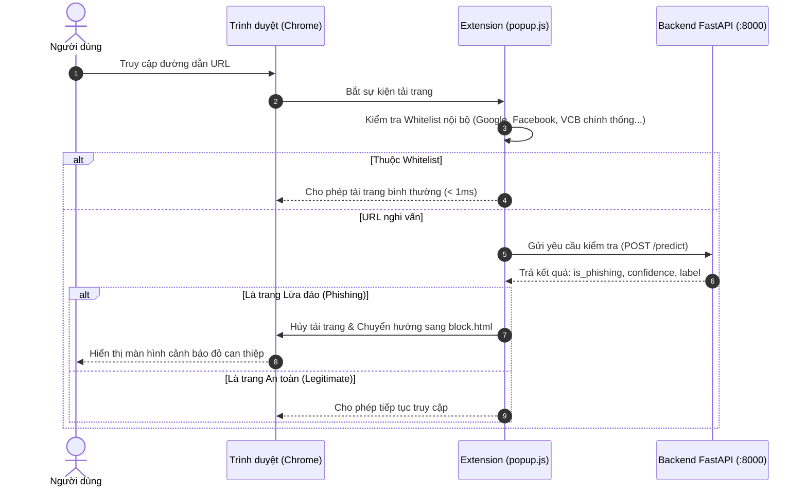

# PhishArmor AI - Browser Extension (Manifest V3)

Phân hệ tiện ích mở rộng trình duyệt (Browser Extension) của hệ thống an ninh mạng **PhishArmor Enterprise**, đóng vai trò là "người gác cổng" trực tiếp trên trình duyệt web của người dùng (Google Chrome, Microsoft Edge, Brave, Cốc Cốc) để phát hiện và ngăn chặn tức thì các liên kết độc hại, lừa đảo trực tuyến.

---

## 1. Kiến Trúc & Tiêu Chuẩn Kỹ Thuật

* **Tiêu chuẩn**: Google Chrome Extension Manifest V3 (Chuẩn kiến trúc bảo mật mới nhất của hệ sinh thái trình duyệt Chromium).
* **Quyền hạn sử dụng (`permissions`)**:
  * `tabs`: Lắng nghe và đọc địa chỉ URL trang web người dùng đang truy cập.
  * `storage`: Lưu trữ cấu hình người dùng cục bộ (bật/tắt bảo vệ thời gian thực, danh sách whitelist cá nhân).
  * `webNavigation`: Bắt sự kiện chuyển hướng trang để kiểm tra URL trước khi mã độc được tải xuống máy.

---

## 2. Cấu Trúc Thành Phần

```text
extension/
├── manifest.json   # Tệp cấu hình siêu dữ liệu, phân quyền và tài nguyên tiện ích
├── popup.html      # Giao diện người dùng tương tác nhanh khi bấm vào icon trên thanh công cụ
├── popup.js        # Logic điều khiển giao diện popup, giao tiếp với Backend API (:8000)
├── block.html      # Màn hình can thiệp cảnh báo đỏ (Red Shield Interception Page)
└── README.md       # Tài liệu kỹ thuật phân hệ
```

---

## 3. Cơ Chế Hoạt Động (Workflow)



---

## 4. Hướng Dẫn Cài Đặt Vào Trình Duyệt

1. Mở trình duyệt Google Chrome hoặc Microsoft Edge.
2. Truy cập vào trang quản lý tiện ích:
   * Trên Chrome: `chrome://extensions/`
   * Trên Edge: `edge://extensions/`
3. Bật công tắc **Chế độ dành cho nhà phát triển (Developer mode)** ở góc trên bên phải màn hình.
4. Nhấn vào nút **Tải tiện ích đã giải nén (Load unpacked)** ở góc trên bên trái.
5. Duyệt và chọn thư mục `extension` trong mã nguồn dự án `Phishing_Project/extension`.
6. Ghim (Pin) biểu tượng khiên PhishArmor lên thanh công cụ trình duyệt để theo dõi trạng thái bảo vệ.

---

## 5. Cơ Chế Báo Cáo Người Dùng (Active Learning Feedback)

* **Trên Popup**: Khi người dùng nghi ngờ một trang web là lừa đảo mà tiện ích chưa chặn, họ có thể bấm nút **"Báo cáo lừa đảo (FN)"**.
* **Trên Màn hình can thiệp đỏ (`block.html`)**: Nếu người dùng cho rằng trang web bị chặn nhầm (False Positive - ví dụ website nội bộ trường học), họ bấm nút **"Báo cáo chặn nhầm (FP)"**.
* Dữ liệu phản hồi được gửi ngay lập tức về máy chủ qua `POST /api/feedback`, hiển thị tại trang duyệt của chuyên viên SOC (`/feedback`) để chuẩn bị nạp vào chu kỳ huấn luyện lại mô hình tiếp theo.

---

## 6. Kịch Bản Kiểm Thử Vận Hành Hệ Thống

* **Kiểm thử liên kết an toàn**: Truy cập `https://vietcombank.com.vn` hoặc `https://dichvucong.gov.vn`. Mở popup tiện ích để thấy trạng thái "Lá chắn an toàn", điểm Trust Score cao (95-100%).
* **Kiểm thử liên kết lừa đảo thử nghiệm**: Truy cập một URL trong danh sách blacklist thử nghiệm (ví dụ: `http://vietcombank-login-otp-security.net`). Tiện ích sẽ lập tức chặn truy cập và chuyển hướng người dùng sang trang `block.html` với cảnh báo bảo mật rõ ràng.
